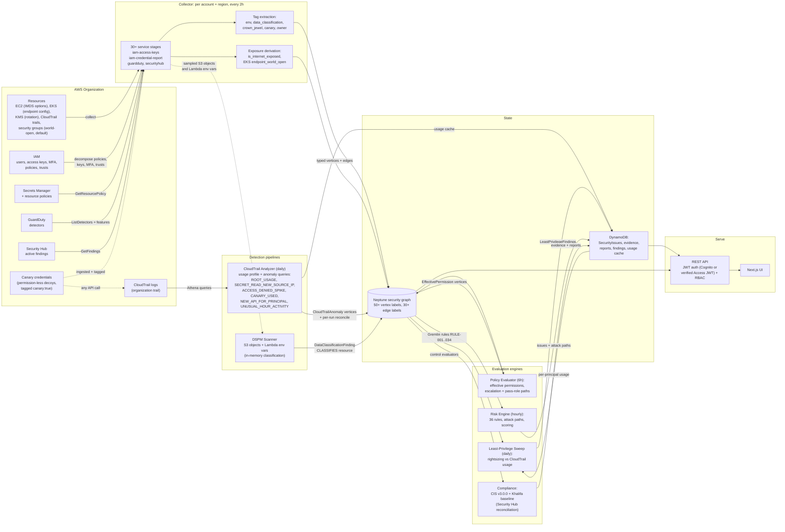

# Khalifa Architecture

## Data Flow

```
                               AWS Org (multi-account)
                                          │
                                          ▼
              ┌──────────────────────────────────────────────────────┐
              │  Step Functions State Machine (every 2h)             │
              │  + EventBridge → SQS → Incremental Updates           │
              └───────────────────────────┬──────────────────────────┘
                                          ▼
              ┌──────────────────────────────────────────────────────┐
              │  Collector Lambda (per account, per region)          │
              │  - STS AssumeRole → SecurityGraphCollectorRole       │
               │  - 30+ AWS service APIs                              │
               │  - Tag ingestion via ResourceGroupsTaggingAPI        │
               │  - Internet exposure derivation (incl. Lambda URLs)  │
               │  - Instance-profile role edges, generic secret inventory│
               │  - Amazon Inspector findings (CVEs on workloads/images)│
               │  - Observed traffic from VPC flow logs (traffic_observed)│
               │  - Cross-account trust analysis                      │
               │  - Bounded graph-writer batches + coverage checkpoint│
              └───────────────────────────┬──────────────────────────┘
                                          ▼
              ┌──────────────────────────────────────────────────────┐
              │  Graph Writer Lambda                                 │
              │  → Neptune (Gremlin)                                 │
              └───────────────────────────┬──────────────────────────┘
                                          ▼
              ┌──────────────────────────────────────────────────────┐
              │  Neptune Security Graph                              │
              │  - 50+ vertex labels                                 │
              │  - 30+ edge labels                                   │
              │  - Tag-derived properties (env, data_class)          │
              └────────────┬────────────────────────────┬────────────┘
                           ▼                            ▼
              ┌──────────────────────────────────────────────────────┐
              │  Risk Engine Lambda    │  │  Compliance Evaluators   │
              │  (every 1h)            │  │  (CIS + baseline)        │
               │  - 34 Gremlin rules    │  │  - per-control evaluators│
              │  - Risk scoring        │  │  - DynamoDB persistence  │
              └────────────┬───────────┘  └─────────────┬────────────┘
                           ▼                            ▼
              ┌────────────────────────┐  ┌──────────────────────────┐
              │  DynamoDB:             │  │  DynamoDB:               │
              │  SecurityIssues        │  │  ComplianceEvidence      │
              │                        │  │  ComplianceReports       │
              └────────────────────────┘  └──────────────────────────┘
                           │                            │
                           └─────────────┬──────────────┘
                                         ▼
              ┌──────────────────────────────────────────────────────┐
              │  api-service (Express on EKS)                        │
              │  - JWT/Cognito auth (jose)                           │
              │  - RBAC: Viewer/Analyst/Admin via Cognito groups     │
              │  - Gremlin query parameterization                    │
              └──────────────────────────┬───────────────────────────┘
                                         ▼
              ┌──────────────────────────────────────────────────────┐
               │  ui (Next.js)                                        │
               │  - /issues, /attack-paths, /secrets, /compliance     │
              │  - Cognito OIDC bearer tokens                        │
              └──────────────────────────────────────────────────────┘
```

## Workflow Map

The full set of concurrent workflows against one graph. Solid arrows are data flow; dashed edges are detection signals.



> [!TIP]
> Reading the map: collection flows from the AWS Organization into the graph; the four detection and evaluation engines loop back over the live graph; all outputs converge in DynamoDB and are served through one RBAC-gated API. The canary credential (dashed) never does legitimate work: its only purpose is to show up in CloudTrail, which the analyzer converts into RULE-023.

## CloudTrail Analyzer

A scheduled Lambda (`lambdas/cloudtrail-analyzer`) runs daily (02:00 UTC) and executes Athena queries over the CloudTrail S3 logs with a configurable lookback window (default 90 days):

- **Usage profile:** per-principal event counts joined with IAM effective permissions by the least-privilege sweep (persisted to `AccessAnalyzerCache` with a 90-day TTL).
- **Anomaly queries (baseline deviations):** root-identity activity; Secrets Manager reads from a source IP absent from the principal's own 30-day source-IP baseline (an IP dormant for the baseline and used again counts as new); and AccessDenied spikes judged per principal and IP against that pair's daily-count baseline — mean + 3 standard deviations (with 10% of the mean as a floor on the spread, and a floor of 10 events), falling back to the previous fixed 20-per-lookback threshold while fewer than 7 baseline days exist (cold start). Each spike records `baseline_mean`, `baseline_stddev`, `baseline_days`, `basis` and `deviation` so the ranking is explainable; the principal's blast radius then ranks it in scoring like any other finding. Anomalies are written as `CloudTrailAnomaly` vertices through the graph writer under the `cloudtrail-anomalies` reconcile scope, so each run removes anomalies that stop appearing. Detection feeds RULE-020, RULE-021, and RULE-022.
- **Canary tripwire:** when `CANARY_PRINCIPAL_ARNS` is set (populated automatically when the CDK stack deploys with `enableCanaries`), any CloudTrail activity from those principals produces a `CANARY_USED` anomaly. Canary keys are permission-less decoys stored in Secrets Manager (`khalifa-canary/credentials-1/2`) and tagged `canary: true`; their only purpose is to appear in CloudTrail when an attacker tries them. RULE-023 treats any use as a critical incident.

## Least-Privilege Sweep

A scheduled Lambda (`lambdas/least-privilege-sweep`) runs daily (03:00 UTC, after the CloudTrail analyzer) and iterates every `IamUser` and `IamRole` across all accounts. For each principal it joins the `EffectivePermission` vertex (Neptune) with actual usage from `AccessAnalyzerCache` (DynamoDB), computes a rightsizing recommendation via the shared `rightsizer` module, and persists the result to the `LeastPrivilegeFindings` table. Service-linked roles (`/aws-service-role/`) and principals with only AWS-managed policies are skipped.

## Path likelihood and fix simulation

Beyond severity, every matched path carries an explainable **likelihood**: the
product of five visible factors — exposure, privilege (identity blast radius),
exploitability (Amazon Inspector CVSS/exploit data), reachability (halved
when a vertex says its exposure or state could not be read) and **coverage**,
the freshness of the graph the path was read from. Unknown detail is a
mid-value, not zero, and the factors are persisted with the value (issue
metadata, attack-path search results) so a ranking can be argued with; it is a
v1 heuristic, calibrated against outcomes only in a later phase.

Freshness tempering is deterministic and shared: the collector cadence grades
coverage (`fresh` ≤ 8h, `aging` ≤ 72h, `stale` beyond — the levels and
thresholds live in `packages/risk-engine/src/coverage.ts`, one source of truth
for the API statements, the runner and the plan report) and the level scales
the likelihood — `aging` × 0.8, `stale` × 0.5. `unknown` (no collection
recorded, or a failed read) is deliberately **not** discounted: the surfaces
label it in words instead, so a fresh install is not punished, while a graph
that is provably old can never look confident. The rule runner resolves the
level once per run (newest `CollectionCoverage` SUCCEEDED completion, bounded
and failure-tolerant) and stamps `metadata.coverageLevel` on every issue it
creates or refreshes; the explorer, the fix panel and the scenario runner each
attach the statement — and show its note — beside their results.

`GET /attack-paths/simulate?ruleId=…` re-runs one rule against the live graph
(bounded at 200 paths / 10 edges) and counts, per edge on the matched paths,
how many paths traverse it — the "what removes these paths" panel on the issue
page. Removal is simulated by filtering the returned paths, not by mutating the
graph, and the top row is the cheapest fix for the most (or worst) paths.

## Trajectory forecasting

The rule runner writes three more daily series beside the issue counts: the
backlog's total risk score (a few criticals weigh more than many lows), mean
time to resolution over issues resolved in the last 30 days, and the
admin-principal count from the policy evaluator's findings. `GET
/trends/:metric` fits an explainable least-squares line over the window and
returns 7/30-day projections with a residual band and a confidence level
derived from fit quality and point count — degraded a level, with the reason in
`note`, when no runner pass recorded in two days or the window has three or
more missing days. The Trends page renders the projection beside the series.
Publishing projections to the trust center is deferred until the publishable
discipline covers them.

## Rule quality and calibration

Every issue a rule raises ends open, suppressed (an analyst judged it not worth
fixing, or accepted the risk — the reason and actor are recorded in its status
history), or resolved on its own when the graph stopped matching. `GET
/rules/quality` joins those counts (the same bounded `StatusIndex` reads the
issue summary uses) with the catalogue and publishes per-rule
`dismissalRate = suppressed ÷ handled` plus a verdict (`reliable` when the rate
stays under 20% over at least 10 closed issues, `noisy` at 50% or more, `mixed`
between, `insufficient-data` before that). It is a noise proxy, not ground
truth. Beside it the runner labels every issue with **independent-detector
corroboration**: once per run it resolves the resources Security Hub /
GuardDuty findings point at (`DETECTS_ON`, one bounded read, truncation-aware,
failure-tolerant) and records `metadata.independentFinding` — true when one of
the issue's resources was flagged too, false when the complete set missed it,
absent when the set was unreadable, truncated, or the rule _is_ those detectors
(RULE-018/029). `/rules/quality` publishes `corroborationRate =
corroborated ÷ labeled` once at least five issues are labelled, and the verdict
deliberately stays dismissal-based until that data and a calibration decision
support moving it. The thresholds are explicit constants,
and severity, scoring-weight, or auto-ticket changes cite the report as
evidence — per the parity port's decision, RULE-006/031–034 stay off auto-ticket
until their measured rate supports turning it on.

## Pre-deploy plan analysis

`scripts/risk-plan` (`npm run risk:plan -- plan.json`) reads a `terraform
show -json` document and predicts, before anything is deployed, which catalogue
rules the planned creations and updates would feed — world-open security-group
ingress, account-root and `Principal: *` trusts, public bucket ACLs or
policies, public RDS, world-open EKS endpoints, unauthenticated function URLs,
anyone secret policies, and instances left on IMDSv1 — printing each finding's
detail and the path shape the live graph would draw, and exiting non-zero at a
configurable severity. It is attribution, not simulation: a plan knows less
than collection (data classification, which accounts are collected, the real
topology), so findings state what collection would add, and ports no catalogue
rule covers yet are marked as such rather than given an invented rule id.

The gate widens beyond Terraform plans: IAM policy documents embedded in the
plan (`aws_iam_policy` / `aws_iam_role_policy`) are parsed with the **same
policy parser the CIEM evaluator runs**, and a policy that newly grants
`iam:PassRole` on `Resource: "*"` fails it as critical (with a before-policy —
plan `change.before` or `--policy-before` — the checks are a true diff: an
unchanged grant is not newly introduced; statement conditions, SCPs and
permission boundaries are not evaluated and findings say so). Standalone
files cover flows outside Terraform: `--policy after.json [--policy-before
before.json]`. `--helm-values values.yaml` flags the chart values that decide
network reach: an ingress annotated internet-facing is high, a plain enabled
ingress is a medium note (the controller's default decides). All inputs share
one report and one exit code, so teams can wire the same optional CI gate to
plan, policy and chart changes.

## Observed reachability

Flow logs are the one signal that says where traffic actually went. The
optional `flow-log-analyzer` (runtime command; CronJob suspended by default)
queries the `vpc_flow_logs` Glue table — partition projection over
account/region/day, the standard v5 fields with the account id taken from the
partition — for ACCEPT flows per network interface within a bounded window
(default 7 days, max 31, at most 5000 interfaces per run) and writes
`TrafficObservations` in DynamoDB (one row per interface, TTL 30 days). A
second, bounded aggregation runs alongside it: the top remote senders
(`srcaddr`) per interface, ranked by bytes via a window function and capped at
5 per interface with a parsed-row cap, stored as a small endpoint list on the
observation row — two Athena scans per run, one extra bound, and a failure in
the endpoint query degrades to observations without citations. The
collector reads the table during EC2 collection with the hub's own
credentials and marks each instance `traffic_observed` (latest observation
time, and the deduplicated top endpoints, biggest senders first, capped at 5,
as `observed_endpoints`); member-account credentials never read it.
Reachability confidence in path likelihood is then **observed AND configured**:
traffic observed on a workload proves reachability even when a restricted read
left the configuration unknown, and the graph, the attack-path explorer and
the issue page cite it — a hop that arrives at an observed workload shows an
"observed traffic from <address>" chip, and issues store the per-hop citations
(`observedTraffic`) in their metadata. Everything is cost-gated: Terraform
creates nothing without `flow_logs_bucket`, the CronJob ships suspended, and a
deployment without the table simply has no observed traffic.

## Threat-intelligence matching

Customer-supplied intelligence arrives as plain S3 lists (one indicator per
line): `threat-intel-import` validates them (IPs v4/v6, 12-digit account ids,
CVE ids), caps each list, and writes `ThreatIndicators` with a TTL — freshness
is the TTL, so an indicator dropped from a list drains itself. Four types:
`ip` and `account`, plus `cve` (known-exploited membership — an export of the
CISA KEV catalogue's CVE ids) and `epss` (lines of `CVE-YYYY-NNNN,score`,
the first two columns of the FIRST EPSS CSV). Nothing here calls the internet:
AWS's own managed reputation lists need no import because GuardDuty applies
them and the findings they drive already feed RULE-018/RULE-029. The rule
runner joins the store against the facts rules already match: an anomaly's
`source_ip`, a trusted `ExternalAccount`'s account id, and a `Vulnerability`
vertex's `cve_id` (candidate for both CVE lookups). An ip/account match adds a
flat **+10 threat-intelligence factor** to the risk score (a fact about the
path, not a proportional strength; recorded as `threatIntelMatches` on the
issue and labelled on the score card); a `cve` match marks the exploit
available and an `epss` score rides the shared exploitability value
(`max(CVSS/10, EPSS)`, +0.2 for a known exploit — the same helper the
likelihood and the score both use, so they cannot disagree). Matches clear on
refresh once the indicator is gone. Matched issues do **not** auto-ticket
until `/rules/quality` shows the measured precision P6 requires; the local
`scripts/risk-plan` gate is unaffected (it has no store to read, so it never
claims a match).

## ATT&CK mapping and adversary scenarios

Every rule carries a curated, reviewed MITRE ATT&CK mapping
(`attack-techniques.ts`, pinned to the catalogue by a test like the compliance
citations): the technique ids, names, and tactics a finding can be a step of.
They ride on the rule catalog endpoint, on each issue's metadata, and as an
"ATT&CK techniques" card on the issue page. `attack-scenarios.ts` curates
chains of existing rules ("Internet exposure to admin", "Leaked credential to
data access", "CI/CD to cloud takeover"); running one is **graph-only
emulation**: each step re-runs that rule's query against the live graph —
deduped and capped like the fix simulation, per-step errors recorded while the
rest continue — and reports how many of the chain's steps the current findings
already match, with the resources on the matched paths. Nothing is executed
and no AWS call is made: it is attribution over what the collectors see, and
`GET /attack-scenarios/:id` says exactly that.

## Coverage statements on predictive surfaces

Every surface that predicts over the collected graph states how fresh it is:
`/attack-paths/simulate` and `/attack-scenarios/:id` attach a shared coverage
statement computed from `CollectionCoverage` — the newest SUCCEEDED
`resource-inventory` completion, graded `fresh` (≤ 8h, one collection window),
`aging` (≤ 72h) or `stale`, and `unknown` when unreadable — so a count from a
days-old graph cannot look confident. `risk:plan` states `plan-time` coverage
with its own caveat: it reads the plan, not the graph. Failures degrade the
statement, never the prediction.

## Event-triggered recompute

Escalations used to appear only on the policy evaluator's schedule, so a new
admin grant or trust could sit unevaluated for hours. The incremental
collector now signals when a batch could have moved one: any IAM node
(`IamRole`, `IamUser`, `IamGroup`, `IamPolicy*`, `AccessKey`) or IAM edge
(`TRUSTS`, `HAS_IAM_ROLE`, `ATTACHED_TO`, `MEMBER_OF`, `HAS_ACCESS_KEY`) makes
the batch recompute-worthy, and the collector sends one message to the
`recompute` FIFO queue (`RECOMPUTE_QUEUE_URL`; best-effort — a missing queue or
send failure never fails collection). Two bounds keep the heaviest job in the
system from running constantly: the producer's FIFO deduplication id collapses
a five-minute burst to one message, and the recompute worker — a Deployment
that long-polls the queue — refuses to evaluate more often than
`RECOMPUTE_MIN_INTERVAL_SECONDS` (default 900), deleting messages that arrive
inside the interval as covered by the run that just happened. It runs the
**policy evaluator** only, so escalation paths (and the likelihood on any path
through them) refresh within one incremental cycle; the hourly rule run is what
raises the corresponding issues. A failed evaluation leaves its messages for
SQS redelivery and the queue's DLQ rather than deleting them. The CDK path is
not wired (the scheduled evaluator still covers it).

## Compliance reconciliation and the trust center

The compliance job evaluates the CIS AWS Foundations v3.0.0 and Khalifa
baseline controls against the graph, then reconciles CIS with Security Hub:
it assumes the audit account's read-only reader role (granted through
`khalifa-data.securityhub_reader_role_arn`) and compares each requirement per
account (and Region for regional controls) with Security Hub's CIS v3.0.0
findings. The result is stored as a `CIS_RECONCILIATION` record in the reports
table: per-requirement Security Hub and Khalifa statuses, stability streaks and
the disagreeing accounts. None of that detail ever reaches the public page.

Publication follows Security Hub, the CIS v3.0.0 reference: a requirement is
publishable only when listed in `reconciliation.publishAllowlist` (empty by
default, so nothing is), Security Hub has a result with no missing data, and
its status (FAILED when any account/Region fails, otherwise PASSED) has held
for `reconciliation.minAgreementDays` with no gap in records. The Khalifa
comparison, disagreements and agreement streaks stay in the record for triage
but no longer block publication.
`GET /compliance/reconciliation/publishable` exposes exactly those
requirements as `{requirement, title, section, status}`, gated to the
Cloudflare Access service token identified by
`reconciliation.trustCenterSyncClientId`; staff roles, Admin included, cannot
call it.

The nightly `Trust center sync` workflow (`scripts/trust-center-sync`) reads
that endpoint, fails closed on `STALE`/`MISSING` records or transport errors,
and builds the static site in `trust-center/` (plain HTML/CSS, statuses only),
which is deployed to Cloudflare Pages. See
[OPERATIONAL.md](OPERATIONAL.md) section J.

Mapped frameworks (SOC 2, ISO 27001, PCI DSS v4.0, NIST SP 800-53 Rev. 5) do
not define their own catalogs: 52 curated requirements cite the canonical controls
(`packages/risk-engine/src/framework-citations.ts`), and their reports derive
from a single canonical assessment pass (no duplicate evaluators, no separate
evidence rows). The publishable endpoint publishes a mapped requirement only
while every mapped control is reconciliation-publishable (CIS) or assessed
PASS/FAIL in the latest Khalifa baseline report; manual or unevaluated controls
keep it off the page, and an unreadable baseline report leaves mapped
frameworks unpublished rather than failing the CIS response. The trust-center
site groups controls under each published framework, and its continuous-
monitoring statement (cadence plus the automatic-unpublish window) derives from
the endpoint's published `maxAgeHours`, so the public claim cannot drift from
the gate.

## Graph Schema

### Vertex Labels

| Label                       | AWS Service         | Required Properties                                                                                                                                                |
| --------------------------- | ------------------- | ------------------------------------------------------------------------------------------------------------------------------------------------------------------ |
| `Internet`                  | (synthetic)         | `is_internet_exposed`                                                                                                                                              |
| `AwsAccount`                | (synthetic)         | `account_id`                                                                                                                                                       |
| `CollectionCoverage`        | (synthetic)         | `account_id`, `region`, `status`, `completed_at`                                                                                                                   |
| `ExternalAccount`           | IAM                 | `account_id`                                                                                                                                                       |
| `Ec2Instance`               | EC2                 | `arn`, `account_id`, `instance_type`, `state`, `public_ip`, `metadata_http_tokens`, `metadata_http_endpoint`, `metadata_http_limit_hop`                            |
| `NetworkInterface`          | EC2                 | `arn`, `subnet_id`, `vpc_id`                                                                                                                                       |
| `SecurityGroup`             | EC2                 | `arn`, `vpc_id`, `is_world_open`, `is_default`                                                                                                                     |
| `SecurityGroupRule`         | EC2                 | `protocol`, `port_from`, `port_to`, `port_range`, `cidr_block`                                                                                                     |
| `Vpc`                       | EC2                 | `arn`, `cidr_block`, `flow_logs_enabled`                                                                                                                           |
| `Subnet`                    | EC2                 | `arn`, `vpc_id`, `is_public`                                                                                                                                       |
| `InternetGateway`           | EC2                 | `arn`                                                                                                                                                              |
| `NatGateway`                | EC2                 | `arn`                                                                                                                                                              |
| `RouteTable`                | EC2                 | `arn`, `vpc_id`                                                                                                                                                    |
| `NetworkAcl`                | EC2                 | `arn`, `vpc_id`                                                                                                                                                    |
| `TransitGateway`            | EC2                 | `arn`                                                                                                                                                              |
| `S3Bucket`                  | S3                  | `arn`, `is_publicly_accessible`, `versioning_enabled`                                                                                                              |
| `IamUser`                   | IAM                 | `arn`, `password_enabled`, `mfa_enabled`, `likely_workload_identity_candidate`                                                                                     |
| `IamRole`                   | IAM                 | `arn`, `has_cross_account_trust`, `is_admin_role`                                                                                                                  |
| `IamPolicy`                 | IAM                 | `arn`                                                                                                                                                              |
| `IamPolicyDocument`         | IAM                 | `arn`, `policy_arn`, `document_json`, `policy_type`                                                                                                                |
| `IamPolicyStatement`        | IAM                 | `arn`, `effect`, `actions`, `resources`, `has_wildcard_resource`, `has_wildcard_action`, `grants_secret_read`, `secret_grant_scope`, `has_cross_account_principal` |
| `IamCredentialReport`       | IAM                 | `arn`, `generated_time`, `user_count`, `users_with_mfa`                                                                                                            |
| `AccessKey`                 | IAM                 | `arn`, `status`, `created_date`, `key_age_days`, `last_used_date`, `last_used_days_ago`                                                                            |
| `AccountPasswordPolicy`     | IAM                 | `min_password_length`, etc.                                                                                                                                        |
| `KmsKey`                    | KMS                 | `arn`, `key_state`, `key_manager`, `rotation_enabled`                                                                                                              |
| `RdsInstance`               | RDS                 | `arn`, `publicly_accessible`, `is_publicly_accessible`, `storage_encrypted`                                                                                        |
| `EksCluster`                | EKS                 | `arn`, `version`, `endpoint_public_access`, `endpoint_private_access`, `public_access_cidrs`, `endpoint_world_open`, `vpc_id`                                      |
| `EcrRepository`             | ECR                 | `arn`, `name`                                                                                                                                                      |
| `ContainerImage`            | ECR                 | `arn`, `digest`, `tag`                                                                                                                                             |
| `LoadBalancer`              | ELBv2               | `arn`, `scheme`, `is_internet_facing`                                                                                                                              |
| `Finding`                   | SecurityHub         | `severity`                                                                                                                                                         |
| `SecurityHub`               | Security Hub        | `arn`, `enabled`                                                                                                                                                   |
| `SecurityHubFinding`        | Security Hub        | `arn`, `severity`, `record_state`, `resource_arn`                                                                                                                  |
| `CloudTrailAnomaly`         | CloudTrail Analyzer | `arn`, `anomaly_type`, `principal_arn`, `source_ip`, `event_count`, `first_seen`, `last_seen`                                                                      |
| `CloudTrail`                | CloudTrail          | `is_multi_region_trail`, `is_organization_trail`                                                                                                                   |
| `ConfigRecorder`            | Config              | `arn`                                                                                                                                                              |
| `ConfigRule`                | Config              | `arn`                                                                                                                                                              |
| `GuardDutyDetector`         | GuardDuty           | `arn`, `status`                                                                                                                                                    |
| `AccessAnalyzer`            | IAM Access Analyzer | `arn`                                                                                                                                                              |
| `LambdaFunction`            | Lambda              | `arn`, `runtime`, `role`, `is_in_vpc`, `has_internet_access`, `function_url_auth_type`, `function_url_public`, `public_invoke_policy`                              |
| `LambdaAlias`               | Lambda              | `arn`                                                                                                                                                              |
| `ApiGateway`                | API Gateway         | `arn`, `endpoint_type`                                                                                                                                             |
| `ApiGatewayStage`           | API Gateway         | `arn`                                                                                                                                                              |
| `StateMachine`              | Step Functions      | `arn`                                                                                                                                                              |
| `EventBus`                  | EventBridge         | `arn`                                                                                                                                                              |
| `DynamoDBTable`             | DynamoDB            | `arn`, `encryption`, `point_in_time_recovery`                                                                                                                      |
| `ElastiCacheCluster`        | ElastiCache         | `arn`, `transit_encryption`                                                                                                                                        |
| `OpenSearchDomain`          | OpenSearch          | `arn`, `encryption_at_rest`                                                                                                                                        |
| `RedshiftCluster`           | Redshift            | `arn`, `publicly_accessible`                                                                                                                                       |
| `Secret`                    | Secrets Manager     | `arn`, `rotation_enabled`, `collection_restricted`, `days_since_rotation`, `days_since_access`                                                                     |
| `Parameter`                 | SSM Parameter Store | `arn`, `type`, `collection_restricted`                                                                                                                             |
| `BackupVault`               | AWS Backup          | `arn`                                                                                                                                                              |
| `BackupPlan`                | AWS Backup          | `arn`                                                                                                                                                              |
| `HostedZone`                | Route53             | `arn`                                                                                                                                                              |
| `DataClassificationFinding` | DSPM Scanner        | `arn`, `pii_types`, `secret_count`, `skipped_kms`, `data_classification`, `data_class_source`, `confidence`, `classifier`                                          |
| `Vulnerability`             | Amazon Inspector    | `cve_id`, `severity`, `cvss_base_score`, `exploit_available`, `fixed_versions`, `inspector_score`, `first_observed_at`, `last_observed_at`                         |
| `EffectivePermission`       | Policy Evaluator    | `principal_arn`, `allowed_actions`, `denied_actions`, `is_admin`, `blast_radius`                                                                                   |
| `EscalationPath`            | Policy Evaluator    | `source_arn`, `target_arn`, `risk_level`, `escalation_type`                                                                                                        |

### Edge Labels

| Edge                           | Meaning                                                             |
| ------------------------------ | ------------------------------------------------------------------- |
| `EXPOSES`                      | Internet → IGW/LB/ExternalAccount                                   |
| `CONTAINS`                     | VPC → Subnet/Instance; Account → Resource; Policy → Statement       |
| `ATTACHED_TO`                  | ENI → Instance; IGW → VPC; IAMPrincipal → Policy                    |
| `PROTECTS`                     | SecurityGroup → NetworkInterface                                    |
| `PART_OF`                      | SecurityGroupRule → SecurityGroup                                   |
| `HAS_IAM_ROLE`                 | EC2/Lambda → IAMRole                                                |
| `GRANTS`                       | IamPolicyStatement → Resource (non-wildcard)                        |
| `TRUSTS`                       | IAMRole → ExternalAccount/Principal                                 |
| `OWNS`                         | Account root → Resource                                             |
| `HAS_FINDING`                  | Account → SecurityHub/AccessAnalyzer finding                        |
| `HAS_ACCESS_KEY`               | IamUser → AccessKey                                                 |
| `HAS_RESOURCE_POLICY`          | Secret → IamPolicyDocument                                          |
| `DETECTS_ON`                   | SecurityHubFinding → collected resource                             |
| `HAS_STATUS`                   | CloudTrail → CloudTrailStatus                                       |
| `IN_SUBNET`                    | LB/NatGW → Subnet                                                   |
| `HAS_ENDPOINT`                 | VPC → VPC Endpoint                                                  |
| `HAS_NACL` / `HAS_ROUTE_TABLE` | VPC → NACL/RouteTable                                               |
| `MEMBER_OF`                    | IamUser → IamGroup                                                  |
| `CAN_ESCALATE_TO`              | IAMPrincipal → IAMRole (assume hops, or a `pass_role` compute link) |
| `SHARES_WITH`                  | IamPolicyStatement → AwsAccount (cross-account share)               |
| `BELONGS_TO`                   | ContainerImage → EcrRepository                                      |
| `RUNS_ON`                      | ContainerImage → workload (not yet created)                         |
| `HAS_CVE`                      | Instance/Lambda/ContainerImage → Vulnerability (Inspector)          |
| `HAS_ALIAS` / `HAS_STAGE`      | Function → Alias/Stage                                              |
| `CLASSIFIES`                   | DataClassificationFinding → S3Bucket/RdsInstance/LambdaFunction     |

### Risk Rule Properties (queried by Gremlin rules)

| Property                                          | Type             | Source                                               |
| ------------------------------------------------- | ---------------- | ---------------------------------------------------- |
| `is_internet_exposed`                             | boolean          | Collector exposure derivation                        |
| `is_publicly_accessible`                          | boolean          | S3/RDS direct fetch                                  |
| `is_in_vpc`                                       | boolean          | Lambda VPC config                                    |
| `has_internet_access`                             | boolean          | Lambda VPC config (inverse)                          |
| `crown_jewel`                                     | boolean          | `crown_jewel` tag                                    |
| `data_classification`                             | string           | `data_classification` tag                            |
| `env`                                             | string           | `env` or `environment` tag                           |
| `has_cross_account_trust`                         | boolean          | IAM trust analysis                                   |
| `has_wildcard_resource`                           | boolean          | IAM policy statement analysis                        |
| `has_wildcard_action`                             | boolean          | IAM policy statement analysis                        |
| `grants_secret_read` / `secret_grant_scope`       | boolean / string | IAM policy statement analysis                        |
| `mfa_enabled` / `password_enabled`                | boolean          | IAM MFA devices and login profiles                   |
| `key_age_days` / `last_used_days_ago`             | number           | IAM access key collection                            |
| `endpoint_public_access` / `endpoint_world_open`  | boolean          | EKS `resourcesVpcConfig`                             |
| `function_url_public` / `public_invoke_policy`    | boolean          | Lambda function URLs and invoke policies             |
| `cvss_base_score` / `exploit_available`           | number / boolean | Amazon Inspector finding (RULE-003, risk scoring)    |
| `lambda_exposure_restricted`                      | boolean          | Lambda reads the collector role cannot make          |
| `principal_is_anyone` / `principal_account_count` | boolean / number | IAM policy statement principal analysis              |
| `principal_org_restricted`                        | boolean          | `aws:PrincipalOrgID` condition on a statement        |
| `is_prod`                                         | boolean          | `PROD_ACCOUNT_IDS` account marking                   |
| `traffic_observed` / `traffic_observed_at`        | boolean / string | Flow-log analyzer observation, read by the collector |
| `anomaly_type`                                    | string           | CloudTrail analyzer anomaly queries                  |
| `port_from` / `port_to`                           | number           | Security group rule                                  |
| `flow_logs_enabled`                               | boolean          | EC2 DescribeFlowLogs                                 |

## Authentication

- **Cognito User Pool** authenticates users; **Cognito Groups** (`khalifa-admin`, `khalifa-analyst`, `khalifa-viewer`) drive RBAC
- **Cloudflare Access** (optional): when `CLOUDFLARE_ACCESS_TEAM_DOMAIN` and `CLOUDFLARE_ACCESS_AUD` are set, the API verifies the `cf-access-jwt-assertion` JWT against the team's Access JWKS and maps verified identities from the configured trusted email domain to Viewer/Analyst (never Admin without a Cognito `khalifa-admin` group)
- **JWKS verification** in api-service via `jose`; email-only headers are never trusted and unauthenticated requests fail closed (`AUTH_NOT_CONFIGURED` when neither provider is configured)
- **ALB OIDC** (EKS deployment) for browser-based UI auth; API service enforces JWT independently

## Deployment Topologies

| Topology                    | Use Case                 | Tradeoffs                    |
| --------------------------- | ------------------------ | ---------------------------- |
| **Lambda + Step Functions** | Small orgs, <50 accounts | Lower operational overhead   |
| **EKS + CronJob**           | Large orgs, >50 accounts | Better scaling, more control |
