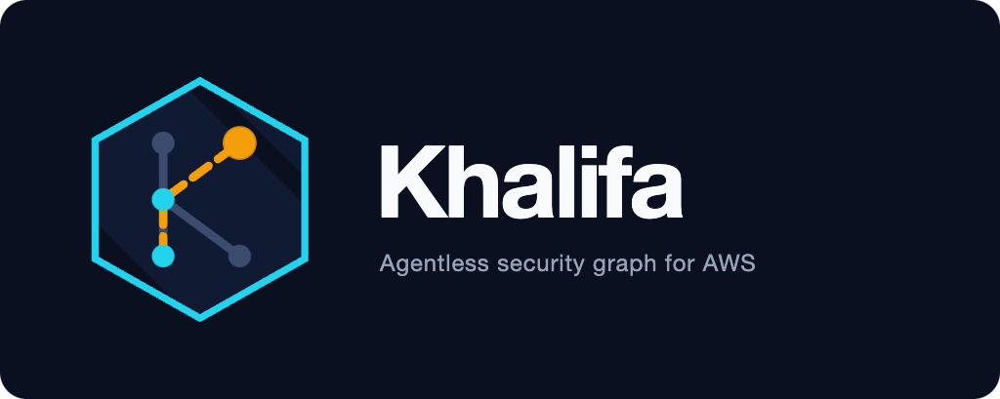

<h1 align="center">
  
</h1>

<p align="center">
<strong>Inventory · Attack paths · CIEM · Compliance</strong><br/>
One member role. Evaluation stays in-account.
</p>

<p align="center">
<a href="ARCHITECTURE.md">Docs</a> · <a href="OPERATIONAL.md">Operations</a> · <a href="CONTRIBUTING.md">Contributing</a>
</p>

<p align="center">
<a href="https://github.com/therandomsecurityguy/khalifa/actions/workflows/ci.yml"></a>
<a href="LICENSE"></a>
<a href="https://nodejs.org"></a>
<a href="https://www.typescriptlang.org"></a>
</p>

---

## Features

| Surface             | What you get                                                                                                                                                                                                                                                                                                                                                                                                                                                                                                                                                                                                                                                                                                                                                               |
| ------------------- | -------------------------------------------------------------------------------------------------------------------------------------------------------------------------------------------------------------------------------------------------------------------------------------------------------------------------------------------------------------------------------------------------------------------------------------------------------------------------------------------------------------------------------------------------------------------------------------------------------------------------------------------------------------------------------------------------------------------------------------------------------------------------- |
| **Collection**      | 30+ AWS services via [`SecurityGraphCollectorRole`](templates/SecurityGraphCollectorRole.yaml). A hub account collects; each member account gets the spoke role.                                                                                                                                                                                                                                                                                                                                                                                                                                                                                                                                                                                                           |
| **Graph**           | Typed vertices and edges in Neptune. Same input, same Gremlin traversal.                                                                                                                                                                                                                                                                                                                                                                                                                                                                                                                                                                                                                                                                                                   |
| **CIEM**            | IAM decomposition, effective permissions, escalation paths (assume chains and `iam:PassRole` to compute, RULE-034), CloudTrail-grounded rightsizing.                                                                                                                                                                                                                                                                                                                                                                                                                                                                                                                                                                                                                       |
| **Least privilege** | Sweep of roles and users. Deployable policy recommendations.                                                                                                                                                                                                                                                                                                                                                                                                                                                                                                                                                                                                                                                                                                               |
| **Secrets**         | Secrets Manager and SSM parameter inventory with who-can-read analysis from identity and resource policies, rotation and access age, sharing detection (RULE-010, RULE-032, RULE-033), and admin users holding active access keys (RULE-031).                                                                                                                                                                                                                                                                                                                                                                                                                                                                                                                              |
| **Risk**            | Scheduled rules and attack-path traversals on the live graph (34 rules), with an exploitability factor that raises scores for paths carrying Amazon Inspector findings, an explainable likelihood on every path (tempered down when the graph it read is aging or stale), escalation paths recomputed within minutes of an IAM change (event-triggered and rate-bounded), a per-fix simulation that counts what each edge removal would clear, matching against customer-supplied threat-intel lists (additive score bonus, TTL-fresh), curated MITRE ATT&CK techniques on every finding, graph-only adversary scenarios that re-run technique chains over the live graph, and a per-rule quality report (suppression vs resolution) that calibrates which rules to trust. |
| **Detection**       | GuardDuty detector coverage per region (including `MISSING`), Security Hub findings joined to internet-exposed resources (RULE-017, RULE-018), CloudTrail anomaly signals: root activity, secret reads from IPs outside each principal's own 30-day baseline, AccessDenied deviations from each principal's own daily baseline (RULE-020 to RULE-022), canary credential tripwires (RULE-023), secret scanning of Lambda environment variables plus IMDSv1-with-role detection (RULE-024), and Amazon Inspector CVEs on internet-exposed workloads (RULE-003).                                                                                                                                                                                                             |
| **Exposure**        | Public EKS control planes (RULE-019) plus public S3/RDS and world-open security groups, derived from collected endpoint and network config, with optional observed traffic from VPC flow logs confirming where traffic actually goes.                                                                                                                                                                                                                                                                                                                                                                                                                                                                                                                                      |
| **Compliance**      | CIS AWS Foundations v3.0 and the Khalifa baseline, per-control evidence, mapped SOC 2 / ISO 27001 / PCI DSS / NIST 800-53 requirements, and CIS reconciliation against Security Hub before anything is publishable.                                                                                                                                                                                                                                                                                                                                                                                                                                                                                                                                                        |
| **Trust center**    | Nightly static trust-center page built from the publishable posture (statuses only, in-repo site).                                                                                                                                                                                                                                                                                                                                                                                                                                                                                                                                                                                                                                                                         |
| **Runtime**         | EKS Helm + `khalifa-eks` / `khalifa-data` / `khalifa-registry`. CDK Lambda remains for the in-repo pipeline.                                                                                                                                                                                                                                                                                                                                                                                                                                                                                                                                                                                                                                                               |
| **Shift-left**      | `npm run risk:plan -- <plan.json>` predicts which rules a Terraform plan would feed (world-open security groups, account-root trusts, public buckets/RDS/EKS endpoints, secret policies, function URLs, IMDSv1) and fails the gate, naming the rule and the predicted path before anything is deployed.                                                                                                                                                                                                                                                                                                                                                                                                                                                                    |

---

## Architecture

| Workload                                               | Where  | Role                                                                                                           |
| ------------------------------------------------------ | ------ | -------------------------------------------------------------------------------------------------------------- |
| [Collector](lambdas/collector)                         | EKS    | Per-account, per-region inventory. Organization and incremental commands reuse this runtime.                   |
| [Graph writer](lambdas/graph-writer)                   | EKS    | Bounded Neptune upserts. ClusterIP-only, token-gated.                                                          |
| [Rule runner](packages/risk-engine)                    | EKS    | Scheduled Gremlin rules and scoring on the live graph.                                                         |
| [Compliance](packages/risk-engine)                     | EKS    | CIS + Khalifa baseline evidence CronJob; reconciles CIS with Security Hub.                                     |
| [API](api-service) / [UI](ui)                          | EKS    | Cognito or Cloudflare Access JWT. Issues, attack paths, compliance, identity.                                  |
| [Policy evaluator](lambdas/policy-evaluator)           | Lambda | Effective permissions, trust edges, rightsizing.                                                               |
| [CloudTrail analyzer](lambdas/cloudtrail-analyzer)     | EKS    | Athena over CloudTrail → AccessAnalyzerCache and anomaly signals written to the graph.                         |
| [Least-privilege sweep](lambdas/least-privilege-sweep) | Lambda | Daily rightsizing vs CloudTrail usage.                                                                         |
| [DSPM scanner](lambdas/dspm-scanner)                   | EKS    | Secret scanning of S3 objects and Lambda environment variables into the graph (Macie primary, regex fallback). |

Full topology: [ARCHITECTURE.md](ARCHITECTURE.md). IRSA and runbooks: [OPERATIONAL.md](OPERATIONAL.md).

---

## Install

Node.js 24, npm 11.

```bash
git clone https://github.com/therandomsecurityguy/khalifa.git
cd khalifa
npm ci
npm run ci:quality
```

```bash
npm test
bash scripts/validate-deployment-modules.sh
```

Member-account access is hub-and-spoke from a dedicated collector account, not the organization management account. The hub IRSA roles (`khalifa-organization-collector` and `khalifa-incremental-collector`) assume `SecurityGraphCollectorRole` in each member account with ExternalId. The member template is [`templates/SecurityGraphCollectorRole.yaml`](templates/SecurityGraphCollectorRole.yaml). In the hub account it runs with `CreateCollectorRole=false` and attaches the collection policy to the two IRSA roles.

---

## Deploy

Reusable packaging is in this repo. Environment wiring is not.

| Module                                                                   | Creates                                                                                       |
| ------------------------------------------------------------------------ | --------------------------------------------------------------------------------------------- |
| [`deploy/terraform/khalifa-registry`](deploy/terraform/khalifa-registry) | Immutable ECR + GitHub OIDC publish role                                                      |
| [`deploy/terraform/khalifa-data`](deploy/terraform/khalifa-data)         | CMK, Neptune, DynamoDB, SQS/SNS, Cognito, secrets, IRSA                                       |
| [`deploy/terraform/khalifa-eks`](deploy/terraform/khalifa-eks)           | Helm release into an existing namespace                                                       |
| [`deploy/helm/khalifa`](deploy/helm/khalifa)                             | API, UI, rule-runner, collectors, graph-writer, compliance, CloudTrail analyzer, DSPM scanner |

A deployment repository pins a release tag, creates namespace `khalifa`, and passes cluster / VPC / account inputs. `helm_values` from `khalifa-data` is non-secret. Runtime credentials stay in Secrets Manager and land as `khalifa-runtime` (`externalSecrets.targetName`).

> [!IMPORTANT]
> Do not copy ExternalId or the graph-writer token into Helm values or Terraform state. `khalifa-eks` will not create the namespace (`create_namespace = false`).

### Getting started (EKS)

[`deploy/terraform/examples/complete`](deploy/terraform/examples/complete) wires all three modules against an existing EKS cluster, including the External Secrets IRSA role that reads the runtime secret. With Terraform 1.7+, an EKS cluster (and its IAM OIDC provider), the External Secrets operator, and Docker:

```bash
cd deploy/terraform/examples/complete
cp terraform.tfvars.example terraform.tfvars && $EDITOR terraform.tfvars

terraform init
terraform apply -var install_chart=false     # AWS data plane + ECR repositories
kubectl create namespace khalifa

# build and push api, ui, rule-runner images, then set their digests in
# terraform.tfvars (the chart only accepts digest-pinned images; see the
# example README, or scripts/smoke-containers.sh for local smoke)

terraform apply                              # install the Helm release
```

Then add yourself to Cognito (`aws cognito-idp admin-add-user-to-group ... khalifa-admin`) and deploy [`templates/SecurityGraphCollectorRole.yaml`](templates/SecurityGraphCollectorRole.yaml) into member accounts. Full walkthrough, ingress/TLS, and teardown notes: [example README](deploy/terraform/examples/complete/README.md).

Collection and compliance share the rule-runner image. Command selects the entrypoint:

| Command                  | Model      | Required configuration                                                                                               | Retry owner                                                                  |
| ------------------------ | ---------- | -------------------------------------------------------------------------------------------------------------------- | ---------------------------------------------------------------------------- |
| `organization-collector` | CronJob    | `AWS_REGION`, collection scope, `HOME_ACCOUNT_ID`, `COLLECTOR_EXTERNAL_ID`, `GRAPH_WRITER_URL`, `GRAPH_WRITER_TOKEN` | batch retries on 503, account retries for transient failures, then Job retry |
| `incremental-collector`  | Deployment | organization settings + `SQS_QUEUE_URL`                                                                              | SQS visibility + DLQ                                                         |
| `graph-writer`           | Deployment | `AWS_REGION`, `NEPTUNE_ENDPOINT`, `GRAPH_WRITER_TOKEN`                                                               | Neptune retries                                                              |
| `compliance`             | CronJob    | `NEPTUNE_ENDPOINT`, `COMPLIANCE_EVIDENCE_TABLE`, `COMPLIANCE_REPORTS_TABLE`                                          | Job retry                                                                    |
| `cloudtrail-analyzer`    | CronJob    | `ATHENA_DATABASE`, `ATHENA_WORKGROUP`, `ATHENA_RESULTS_S3_LOCATION`, `ACCESS_ANALYZER_TABLE`                         | Job retry                                                                    |
| `risk`                   | CronJob    | `NEPTUNE_ENDPOINT`                                                                                                   | Job retry                                                                    |

`COLLECTION_CONCURRENCY` is capped at 20. Every command supports `--check`. Workers drain on `SIGINT` / `SIGTERM`. Graph-writer mutations need a bearer token; NetworkPolicy allows collector pods only.

Release tags publish Lambda archives, the Helm chart, Terraform modules, an npm SBOM, and SHA-256 checksums. The nightly `Trust center sync` workflow renders the publishable CIS posture into the in-repo static trust-center site (`trust-center/`, built with `npm run trust-center:build`) and deploys it to Cloudflare Pages; it is disabled until `TRUST_CENTER_PROJECT` is configured (see [OPERATIONAL.md](OPERATIONAL.md), section J). Digest-only ECR images are published too when the `KHALIFA_AWS_ROLE_ARN` and ECR repository variables from `khalifa-registry` are configured; without them the release ships the packaging artifacts only. Main merges accumulate and the auto-tag job cuts the next tag once `KHALIFA_RELEASE_MIN_COMMITS` commits (repository variable, default 10) have landed since the previous tag, then dispatches the Release workflow (or chains it through the optional `GH_KHALIFA` PAT when one is set).

### CDK / Lambda

[`cdk/`](cdk) is the EventBridge + Step Functions + Lambda path. Use it for synthesis and small-scale runs, not as a second production owner.

```bash
cd cdk
npm install
npm run build
HOME_ACCOUNT_ID=111122223333 \
NEPTUNE_CLUSTER_RESOURCE_ID=cluster-12345678901234567890123456789012 \
COLLECTION_ACCOUNT_IDS=111122223333,222233334444 \
AWS_REGION=us-east-1 \
cdk deploy SecurityGraphIngestionStack
```

`npm run package:lambdas` writes nine archives under `artifacts/lambdas/`. `npm run smoke:lambdas` checks `index.handler`. `npm run smoke:containers` builds the API, UI, and runtime images.

---

## Configuration

EKS uses [`deploy/helm/khalifa/values.yaml`](deploy/helm/khalifa/values.yaml). The UI proxies `/api` to the in-cluster API Service. Lambda uses:

| Variable                           | Description                                                                                | Default                         |
| ---------------------------------- | ------------------------------------------------------------------------------------------ | ------------------------------- |
| `NEPTUNE_ENDPOINT`                 | Neptune Gremlin endpoint                                                                   | —                               |
| `NEPTUNE_ENDPOINT` (auth)          | Graph access uses SigV4 from the execution role; no Neptune auth secret is read            | —                               |
| `ISSUES_TABLE`                     | DynamoDB issues table                                                                      | `SecurityIssues`                |
| `ACCESS_ANALYZER_TABLE`            | CloudTrail usage cache                                                                     | `AccessAnalyzerCache`           |
| `TRAFFIC_OBSERVATIONS_TABLE`       | Observed-traffic cache for the EC2 collector (empty disables the read)                     | `TrafficObservations`           |
| `THREAT_INDICATORS_TABLE`          | Threat-intel indicators read by the rule runner                                            | `ThreatIndicators`              |
| `THREAT_INTEL_IP_LIST_S3_URI`      | s3://bucket/key of the newline-separated IP indicator list (empty disables)                | —                               |
| `THREAT_INTEL_ACCOUNT_LIST_S3_URI` | s3://bucket/key of the newline-separated account-id list (empty disables)                  | —                               |
| `THREAT_INTEL_TTL_DAYS`            | Days an imported indicator stays valid (DynamoDB TTL)                                      | `90`                            |
| `RECOMPUTE_QUEUE_URL`              | FIFO queue the incremental collector signals and the recompute worker drains               | —                               |
| `RECOMPUTE_MIN_INTERVAL_SECONDS`   | Minimum seconds between event-triggered policy evaluations (recompute worker)              | `900`                           |
| `ATHENA_DATABASE`                  | Glue database for CloudTrail                                                               | `khalifa_cloudtrail_db`         |
| `ATHENA_WORKGROUP`                 | Athena workgroup                                                                           | `khalifa-cloudtrail-analysis`   |
| `CLOUDTRAIL_S3_LOCATION`           | CloudTrail S3 prefix                                                                       | `s3://cloudtrail-logs/AWSLogs/` |
| `ANALYSIS_DAYS`                    | CloudTrail lookback                                                                        | `90`                            |
| `AWS_REGION`                       | AWS region                                                                                 | `us-east-1`                     |
| `HOME_ACCOUNT_ID`                  | Account that uses ambient credentials                                                      | —                               |
| `COLLECTOR_EXTERNAL_ID`            | Member-role ExternalId                                                                     | —                               |
| `GRAPH_WRITER_TOKEN`               | Bearer token for `/mutations`                                                              | —                               |
| `COLLECTION_ACCOUNT_IDS`           | Approved account IDs; names come from `ListAccounts` when the hub may call it              | —                               |
| `COLLECTION_PARENT_IDS`            | Approved org root or OU IDs (still requires Organizations APIs)                            | —                               |
| `COLLECTION_REGIONS`               | Approved Regions                                                                           | —                               |
| `GRAPH_WRITER_FUNCTION_NAME`       | Graph-writer Lambda for analyzer anomalies                                                 | —                               |
| `CANARY_PRINCIPAL_ARNS`            | Comma-separated canary IAM user ARNs; any CloudTrail activity becomes RULE-023             | —                               |
| `PROD_ACCOUNT_IDS`                 | Collected accounts that hold production; RULE-032 flags prod secrets shared with the rest  | —                               |
| `SLACK_WEBHOOK_SECRET_ARN`         | Secrets Manager secret with the Slack webhook URL (bare URL or `{"SLACK_WEBHOOK_URL": …}`) | —                               |
| `RATE_LIMIT_PER_MINUTE`            | Per-identity API request limit per minute                                                  | 600                             |
| `RATE_LIMIT_EXPENSIVE_PER_MINUTE`  | Per-identity limit on expensive endpoints (attack paths, resource graph, reports)          | 60                              |
| `DSPM_CLASSIFY_BUDGET_MS`          | Hard CPU budget (ms) for classifying untrusted S3 content per scan                         | 30000                           |
| `NEPTUNE_MUTATION_CHUNK`           | Mutations per Gremlin write traversal (1-200)                                              | 25                              |
| `COLLECTION_STAGE_CONCURRENCY`     | Independent collection stages in flight (1-20)                                             | 4                               |
| `COLLECTION_RESOURCE_CONCURRENCY`  | Per-resource fan-out within a stage, e.g. S3 buckets and tag chunks (1-20)                 | 5                               |

Canary credentials are deployed with `ENABLE_CANARIES=true` in the CDK environment (`cdk/bin/khalifa.ts`): two permission-less IAM users (`khalifa-canary-1/2`) whose access keys are stored in Secrets Manager (`khalifa-canary/credentials-1/2`). The keys have no legitimate use, so any CloudTrail activity from them is treated as a security incident. Off by default.

The Slack sink prefers `SLACK_WEBHOOK_SECRET_ARN` (a bearer-equivalent credential should not ride along as a plaintext Lambda environment variable): the CDK stack stores `SLACK_WEBHOOK_URL` in `khalifa/slack-webhook` at deploy time and grants the risk engine read. The plaintext `SLACK_WEBHOOK_URL` remains only as a local-development fallback.

On EKS, the Helm value `collection.prodAccountIds` renders the same `PROD_ACCOUNT_IDS` for the collectors, and `reconciliation.securityHubRegion` pins the Region the compliance role assumes into for Security Hub reads.

The DSPM scanner reads object content only from buckets in `DSPM_BUCKET_ALLOWLIST` (Terraform: `dspm_bucket_allowlist`); with none configured it can list bucket names but read no objects. Its `DSPM_SCAN_MODE` defaults to `tagged-only`, which samples object content only from buckets tagged `dspm-scan=true`; `all` samples every bucket and `off` disables sampling. Macie-covered buckets are never downloaded in any mode.

The DSPM scanner can be isolated in a VPC with no internet egress by setting `SCANNER_VPC_ID`, `SCANNER_PRIVATE_SUBNET_IDS`, and `SCANNER_AVAILABILITY_ZONES` (optionally `SCANNER_SECURITY_GROUP_ID`) in the CDK environment. When set, the scanner reaches S3, Macie, Lambda, and CloudWatch Logs through interface endpoints only. Off by default.

Event-driven scanning is opt-in via `ENABLE_DSPM_EVENT_TRIGGER=true`: an SQS queue plus a `sqsHandler` Lambda scan individual objects on S3 events for near-real-time detection, in addition to the daily schedule. Point buckets at the queue with an S3 event notification.

> [!NOTE]
> Cross-account trust is the two hub collector IRSA roles plus ExternalId. In the hub account, deploy the member template with `CreateCollectorRole=false` so home-account collection uses the same policy without self-assumption.

---

## API

Unauthenticated: `/health`, `/livez`, `/readyz`, `/metrics`. Everything else needs a Cognito JWT, or a verified Cloudflare Access identity when the Access provider is configured. RBAC groups: `khalifa-admin`, `khalifa-analyst`, `khalifa-viewer`.

| Endpoint                                                                                      | Description                                                                                                                         |
| --------------------------------------------------------------------------------------------- | ----------------------------------------------------------------------------------------------------------------------------------- |
| Endpoint                                                                                      | Description                                                                                                                         |
| --------------------------------------------------------------------------------------------- | ----------------------------------------------------------------------------------------------------                                |
| `GET /session`                                                                                | Signed-in identity and effective role (Viewer+)                                                                                     |
| `GET /rules` · `/rules/:id`                                                                   | Rule catalog with names, owners, severity hints, and ATT&CK techniques (Viewer+)                                                    |
| `GET /rules/quality`                                                                          | Per-rule open/suppressed/resolved counts, the dismissal-rate verdict, and independent-detector corroboration (Viewer+)              |
| `GET /issues`                                                                                 | Filters: `severity`, `team`, `status`, `ruleId`, `limit`, `nextToken`; `order` = `desc` (default) or `asc` (Viewer+)                |
| `GET /issues/:id`                                                                             | Issue plus attack path (Viewer+)                                                                                                    |
| `GET /issues/counts` · `/issues/stats` · `/issues/summary` · `/issues/schedule`               | Counts, statistics, summary, and collection schedule (Viewer+)                                                                      |
| `POST /issues/:id/suppress` · `/issues/:id/reopen`                                            | Suppress or reopen an issue (Analyst+)                                                                                              |
| `GET /attack-paths/search`                                                                    | Presets or a resource to start/end at, `account`, `maxPathLength`; each path carries a likelihood (Viewer+)                         |
| `GET /attack-paths/simulate`                                                                  | Per-fix path counts for a rule, with a coverage statement for the graph they read (Viewer+)                                         |
| `GET /attack-scenarios` · `/attack-scenarios/:id`                                             | Curated ATT&CK technique chains; running one re-evaluates each step's rule over the live graph, with a coverage statement (Viewer+) |
| `GET /accounts`                                                                               | Account IDs and names (Viewer+)                                                                                                     |
| `GET /data-sources`                                                                           | Collection freshness per data source (Viewer+)                                                                                      |
| `GET /secrets` · `/secrets/reader-counts` · `/secrets/:arn`                                   | Secret inventory, reader counts, and one secret's facts and readers (Viewer+)                                                       |
| `GET /resources/:arn` · `/resources/graph`                                                    | Resource with neighbors and issues; graph slice (Viewer+)                                                                           |
| `GET /resources/search` · `/resources/labels` · `/resources/properties` · `/resources/values` | Resource search and label/property explorer (Viewer+)                                                                               |
| `GET /compliance/frameworks`                                                                  | List frameworks; `/:framework`, `/controls`, `/controls/:controlId`, `/report`, `/drift` (Viewer+)                                  |
| `GET /compliance/reconciliation/publishable`                                                  | Sanitized publishable CIS statuses; Cloudflare Access service token only                                                            |
| `GET /identity/effective-permissions/:principal`                                              | Computed effective permissions (Viewer+)                                                                                            |
| `GET /identity/escalation-paths` · `/identity/unused-permissions` · `/identity/trust-graph`   | CIEM views (Viewer+)                                                                                                                |
| `GET /identity/rightsizing/:principal`                                                        | Least-privilege recommendation (Viewer+)                                                                                            |
| `GET /identity/least-privilege`                                                               | Sweep findings, `/summary`, and per-principal detail (Viewer+)                                                                      |
| `GET /trends` · `/trends/:metric`                                                             | Posture trend metrics and series, each with a 7/30-day projection and confidence (Viewer+)                                          |
| `GET /integrations/status`                                                                    | Issue sink status (Viewer+)                                                                                                         |

```bash
curl "https://api.example.com/api/issues?severity=critical&status=open&limit=100" \
  -H "Authorization: Bearer $TOKEN"
```

---

## Compliance

Gremlin evaluators write pass / fail / manual evidence to DynamoDB. 89 controls: 55 evaluated by automated evaluators, 10 judged from their mapped rules, and 2 manual.

| Framework                | Controls | Focus                                                                     |
| ------------------------ | -------: | ------------------------------------------------------------------------- |
| CIS AWS Foundations v3.0 |       47 | IAM, storage, logging, monitoring, networking, data protection            |
| Khalifa baseline         |       42 | Detection, Kubernetes, secrets and vulnerability management, attack paths |

The compliance job also runs the CIS reconciliation: it reads Security Hub's CIS
v3.0.0 control findings through the audit account's read-only reader role and
stores a `CIS_RECONCILIATION` record (per-requirement Security Hub and Khalifa
statuses, stability and staleness; the comparison stays for triage).
`/compliance/reconciliation/publishable` follows Security Hub, the CIS v3.0.0
reference: it exposes only the requirements that appear in
`reconciliation.publishAllowlist`, have a Security Hub result with no missing
data, and whose status has held for `reconciliation.minAgreementDays`; runbooks
in [OPERATIONAL.md](OPERATIONAL.md), section J.

SOC 2, ISO 27001, PCI DSS v4.0, and NIST SP 800-53 Rev. 5 are integrated by
**mapping**: 52 curated requirements (SOC 2 CC6/CC7/CC9, ISO Annex A, PCI DSS
v4.0, and selected NIST SP 800-53 Rev. 5 controls) cite the canonical controls
above (`packages/risk-engine/src/framework-citations.ts`), so one evaluation
pass and one evidence store serve every framework — e.g. SOC 2 CC9.1 cites
KH-2.5, KH-2.8 and KH-2.10. A mapped requirement passes only
while every mapped control passes; manual or unevaluated controls keep it from
passing. The API serves them like any other framework, control pages link both
ways ("Evidenced by" / "Cited by framework requirements"), and nothing is ever
reported as certified.

---

## Repository

| Path                                                                                                       | Contents                                                                                                                                     |
| ---------------------------------------------------------------------------------------------------------- | -------------------------------------------------------------------------------------------------------------------------------------------- |
| [`lambdas/`](lambdas)                                                                                      | Collector, incremental, graph-writer, policy-evaluator, CloudTrail, flow-log, threat-intel import, recompute, least-privilege, DSPM, runtime |
| [`packages/risk-engine`](packages/risk-engine)                                                             | Rules, scoring, compliance                                                                                                                   |
| [`api-service/`](api-service) · [`ui/`](ui)                                                                | REST API and Next.js UI                                                                                                                      |
| [`deploy/`](deploy)                                                                                        | Helm chart, Terraform modules, fixtures                                                                                                      |
| [`AGENTS.md`](AGENTS.md)                                                                                   | Secure AWS install workflow and repo conventions for AI agents                                                                               |
| [`SECURITY.md`](SECURITY.md)                                                                               | Vulnerability disclosure policy and safe harbor                                                                                              |
| [`templates/`](templates)                                                                                  | Member collection role (`SecurityGraphCollectorRole`)                                                                                        |
| [`scripts/`](scripts)                                                                                      | Helm/Terraform validation, Helm kind smoke, container smoke, Lambda package/smoke, trust-center sync, pre-deploy plan risk, npm audit        |
| [`trust-center/`](trust-center)                                                                            | In-repo static trust-center site generated from the publishable posture                                                                      |
| [`cdk/`](cdk)                                                                                              | Lambda + EventBridge stack                                                                                                                   |
| [`ARCHITECTURE.md`](ARCHITECTURE.md) · [`OPERATIONAL.md`](OPERATIONAL.md) · [`CHANGELOG.md`](CHANGELOG.md) | Design, runbooks, history                                                                                                                    |

---

## License

BSD 3-Clause. See [LICENSE](LICENSE).
